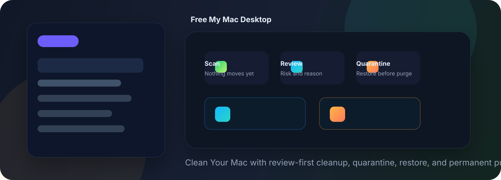
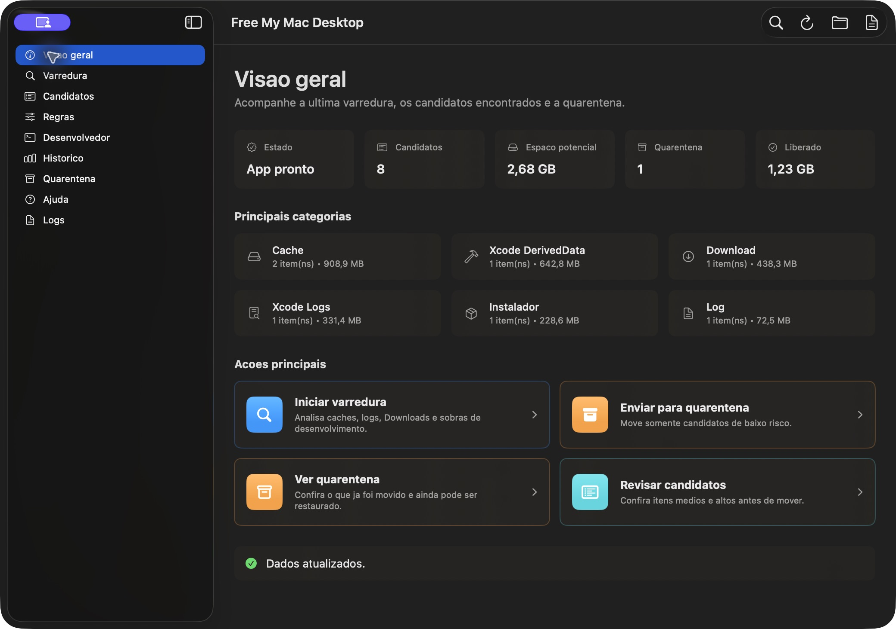
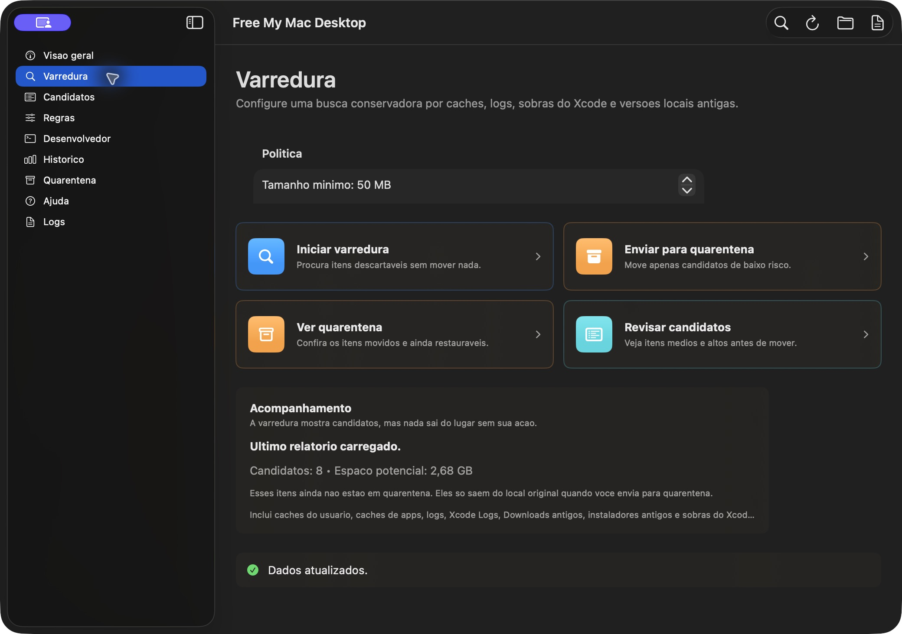
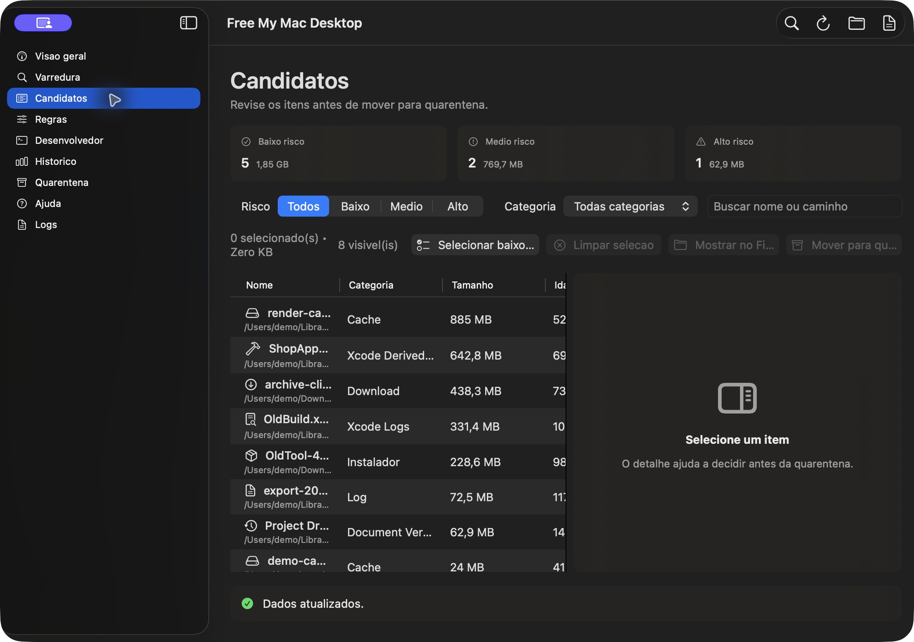
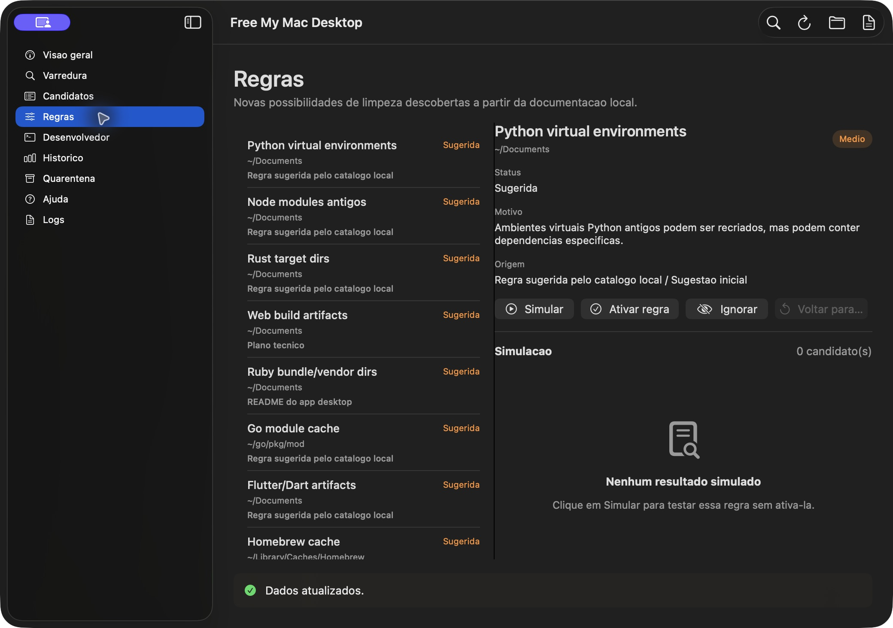
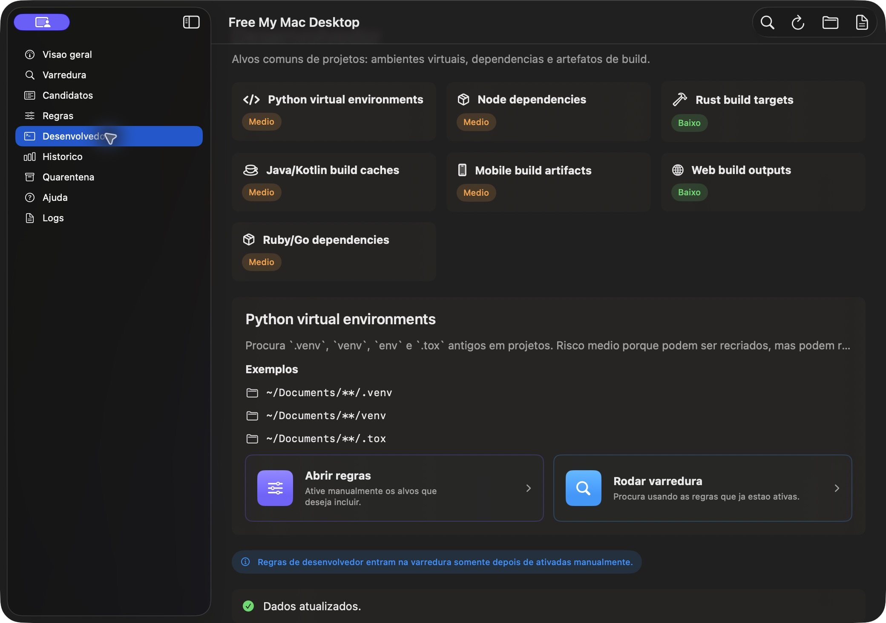
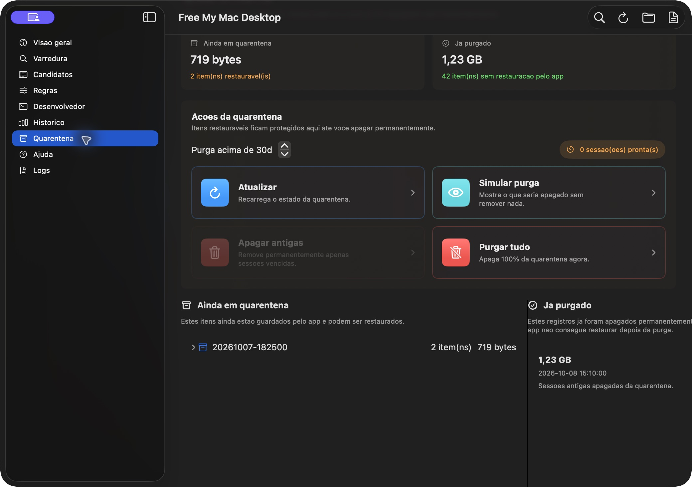

<p align="center">
  
</p>

# Free My Mac Desktop

**Free My Mac Desktop** is a native macOS cleanup assistant built around one rule: nothing should disappear before you review it.

The product direction is **Clean Your Mac**: a calm, Mac-native workflow for finding caches, logs, downloads, developer artifacts, old local document versions, and other reclaimable space with quarantine, restore, and explicit permanent purge.

## Highlights

- Native SwiftUI/AppKit desktop app with sidebar navigation and toolbar actions.
- Conservative scan engine for user caches, app caches, logs, Downloads, installers, Xcode leftovers, and developer build artifacts.
- Candidate review with category, size, age, reason, risk level, search, filters, and a detail panel.
- Quarantine-first cleanup: files are moved to a reversible local quarantine before any permanent removal.
- Restore flow for individual items or full quarantine sessions.
- Purge simulation and explicit permanent purge for old quarantine sessions.
- Cleanup history with permanently freed space.
- Rule discovery from local project documentation, with manual activation and simulation before use.
- Developer-focused targets for `.venv`, `node_modules`, Rust `target`, Java/Kotlin caches, mobile builds, web build outputs, Ruby, and Go.
- Python CLI and local web fallback for auditability and automation.

## Screenshots

### Overview

The dashboard summarizes the current state, candidate volume, potential space, quarantine state, and main actions.



### Scan

Configure the minimum size, age threshold, and optional broader locations before scanning. A scan only reports candidates.



### Candidates

Review every item before quarantine. Filters, risk buckets, search, and the detail panel help decide what is safe to move.



### Rules

Rules discovered from local documentation can be simulated, activated, ignored, or reset. Suggested rules do not affect scans until explicitly activated.



### Developer

Developer cleanup targets are grouped by ecosystem so build artifacts and dependency folders stay easy to reason about.



### Quarantine

Quarantined files stay restorable until a separate purge action removes them permanently.



## How Cleanup Works

1. **Scan** local locations using conservative rules.
2. **Review** candidates by reason, path, size, age, and risk.
3. **Quarantine** selected items. This moves files but keeps a manifest with original paths.
4. **Restore** anything that should return to its original location.
5. **Purge** old quarantine sessions only after a separate confirmation.

The scan phase never deletes or moves files.

## Native App Usage

Build and open the macOS app:

```bash
cd ~/Documents/dev/free-my-mac-desktop
./desktop-mac/build_app.sh
open "desktop-mac/build/Free My Mac Desktop.app"
```

Open the Swift package in Xcode:

```bash
cd ~/Documents/dev/free-my-mac-desktop
./desktop-mac/open_in_xcode.sh
```

The app stores local reports, logs, and quarantine state in this project:

```text
reports/native-latest.json
reports/native-latest.md
reports/cleanup-history.json
logs/
quarantine/
```

## CLI Usage

Run the engine directly:

```bash
cd ~/Documents/dev/free-my-mac-desktop
python3 run_cleaner.py --help
```

Install editable commands:

```bash
cd ~/Documents/dev/free-my-mac-desktop
python3 -m pip install -e .
free-my-mac --help
```

Generate a report:

```bash
python3 run_cleaner.py scan --output reports/scan.json --markdown reports/scan.md
```

Move reviewed candidates to quarantine:

```bash
python3 run_cleaner.py quarantine --report reports/scan.json --ids cache-0001 log-0003
```

Restore from quarantine:

```bash
python3 run_cleaner.py restore --session 20260919-120000 --ids cache-0001
```

Preview and then execute permanent purge:

```bash
python3 run_cleaner.py purge --older-than-days 30
python3 run_cleaner.py purge --older-than-days 30 --execute
```

Legacy commands `mac-safe-cleaner` and `mac-safe-cleaner-web` remain available for compatibility.

## Local Web Fallback

The local web UI is useful for development and Docker workflows. The native app is the primary experience.

```bash
cd ~/Documents/dev/free-my-mac-desktop
python3 -m pip install -e .
free-my-mac-web
```

Then open:

```text
http://127.0.0.1:8080
```

Docker:

```bash
cd ~/Documents/dev/free-my-mac-desktop
docker compose up --build
```

The Compose setup mounts:

- `$HOME` at `/host-home`;
- `./quarantine` at `/data/quarantine`;
- `./reports` at `/data/reports`.

## Visual Identity

Free My Mac Desktop should feel like a native utility: quiet, trustworthy, direct, and reversible.

### Brand Voice

- **Clear:** every cleanup item needs a reason.
- **Calm:** avoid fear-based copy and urgency.
- **Reversible:** quarantine and restore are first-class ideas.
- **Technical when useful:** show paths, sizes, ages, manifests, and risk labels.

### Palette

| Token | Hex | Use |
| --- | --- | --- |
| Graphite | `#111827` | Window background, README cover |
| Panel | `#1F2937` | Cards and grouped surfaces |
| Aqua | `#19B7FF` | Scan, search, primary action |
| Teal | `#27D5C7` | Review and candidate clarity |
| Mint | `#28D17C` | Ready, restored, safe state |
| Amber | `#FFB547` | Quarantine and caution |
| Coral | `#FF7A59` | Destructive purge warnings |
| Text | `#E5EEF7` | Primary text on dark surfaces |
| Muted | `#95A3B8` | Secondary text |

### UI Principles

- Use native macOS controls first: sidebar, toolbar, tables, segmented filters, steppers, toggles, and confirmation dialogs.
- Keep destructive actions visually separate from scan and review actions.
- Show the path and the reason before any file moves.
- Prefer compact operational screens over landing pages.
- Use color as state: aqua for scan, teal for review, amber for quarantine, mint for ready/restored, coral for permanent deletion.

## Safety Policy

- A scan never removes files.
- The first real cleanup action is quarantine.
- Permanent deletion is always a separate purge action.
- Symlinks are not followed.
- Protected system paths are avoided.
- New cleanup categories should start as visible, reviewable candidates with risk labels.
- Developer and documentation-derived rules should be simulated or manually activated before they affect normal scans.

## Development

Read [AGENTS.md](AGENTS.md) before implementation work.

Python checks:

```bash
rtk python3 run_cleaner.py scan --output /tmp/free-my-mac-scan.json --markdown /tmp/free-my-mac-scan.md --min-size-mb 999999
rtk python3 -m compileall src run_cleaner.py
```

Native app checks:

```bash
rtk swift build --package-path desktop-mac
rtk ./desktop-mac/build_app.sh
```
